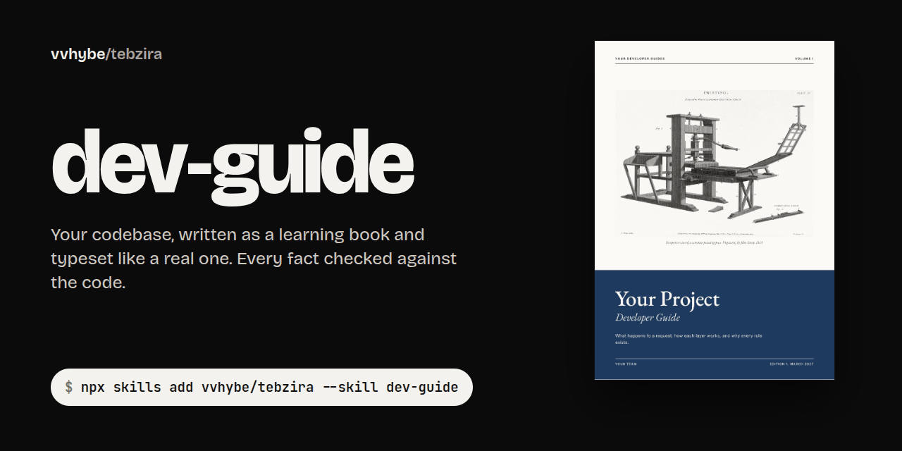

<p align="center">
  
</p>

<p align="center">
  <a href="https://github.com/vvhybe/skills/actions/workflows/check.yml"></a>
  <a href="LICENSE"></a>
  <a href="https://agentskills.io"></a>
  <a href="#install"></a>
  <a href="#the-skills"></a>
</p>

# vvhybe/skills

These are the agent skills I use in my own work. Each one started as a private skill on a real project, got rewritten every time an owner said "not quite", and is shared here once it held up. They're not prompt collections: each is a method, with the scripts that check it and the traps it already fell into.

## The skills

<table>
  <tr>
    <td width="50%" valign="top">
      <a href="skills/site-upgrade/README.md"></a>
      <h3><a href="skills/site-upgrade/README.md">site-upgrade</a></h3>
      <p>Turns a website into one its owner is proud to show: true claims, a design from the brand's own material, signature moments, a contact form that really delivers, SEO and security headers, a scored critique in a real browser, and PRs the team can review.</p>
      <p><sub>Built on an app's marketing site, its help center and a B2B company site taken through two directions.</sub></p>
      <pre lang="bash">npx skills add vvhybe/skills --skill site-upgrade</pre>
    </td>
    <td width="50%" valign="top">
      <a href="skills/dev-guide/README.md"></a>
      <h3><a href="skills/dev-guide/README.md">dev-guide</a></h3>
      <p>Writes a developer guide for any repository as a learning book, every fact checked against the code, then typesets it as a PDF and a Word file with a publisher-grade cover: a public-domain engraving, one colour per volume, sibling repos as a series.</p>
      <p><sub>Built on three related production repositories, now Volumes I to III of one set.</sub></p>
      <pre lang="bash">npx skills add vvhybe/skills --skill dev-guide</pre>
    </td>
  </tr>
</table>

Each skill's own page has its showcase, how it works, its tools and what's inside.

## What they share

- **Evidence over taste.** Every claim on a website, and every fact in a guide, traces to a source. Rules in these skills come from things that happened on real projects.
- **Real material over decoration.** The product itself, real outputs, a real engraving, never stock illustration or a fake dashboard.
- **Look before you say "done".** Real browsers, every page, at every width that matters, with scripts for what can be measured and a written critique for what can't.
- **Safe on input you don't control.** The scripts read and measure; they never change the project they inspect, never leak a local file into an output, and never need an API key.
- **Small in context.** Each `SKILL.md` is a map. The detail lives in `references/`, read one file at a time, when the agent reaches that step.

## Install

**Any agent that reads [Agent Skills](https://agentskills.io)** (Claude Code, Codex, Cursor, Gemini CLI and others), with the [`skills` CLI](https://github.com/vercel-labs/skills):

```bash
npx skills add vvhybe/skills                        # choose from the list
npx skills add vvhybe/skills --skill site-upgrade   # or name one
```

<details>
<summary><b>Claude Code plugin</b></summary>

```
/plugin marketplace add vvhybe/skills
/plugin install site-upgrade@vvhybe
/plugin install dev-guide@vvhybe
```

</details>

<details>
<summary><b>From a clone, linked so <code>git pull</code> updates them</b></summary>

```bash
git clone https://github.com/vvhybe/skills.git ~/src/vvhybe-skills
ln -s ~/src/vvhybe-skills/skills/site-upgrade ~/.claude/skills/site-upgrade
ln -s ~/src/vvhybe-skills/skills/dev-guide ~/.claude/skills/dev-guide
```

</details>

## What's here

```text
skills/
├── site-upgrade/      SKILL.md, references, scripts, assets, evals, and its README
└── dev-guide/         SKILL.md, references, scripts, assets, evals, and its README
docs/                  each skill's banner, showcase and case studies
tests/                 regression tests for the scripts, run in CI
scripts/validate.mjs   checks every skill: frontmatter, size, links, scripts parse
```

`npm run check` runs the validator and every test.

## Contributing

The most useful contribution is a [field report](https://github.com/vvhybe/skills/issues/new?template=field-report.yml): you ran a skill on a real project, and here's what happened. Rules here come from shipped work, so evidence beats opinion. See [CONTRIBUTING.md](CONTRIBUTING.md) for the writing style and the checks.

## License

[MIT](LICENSE) © [vvhybe](https://github.com/vvhybe)
