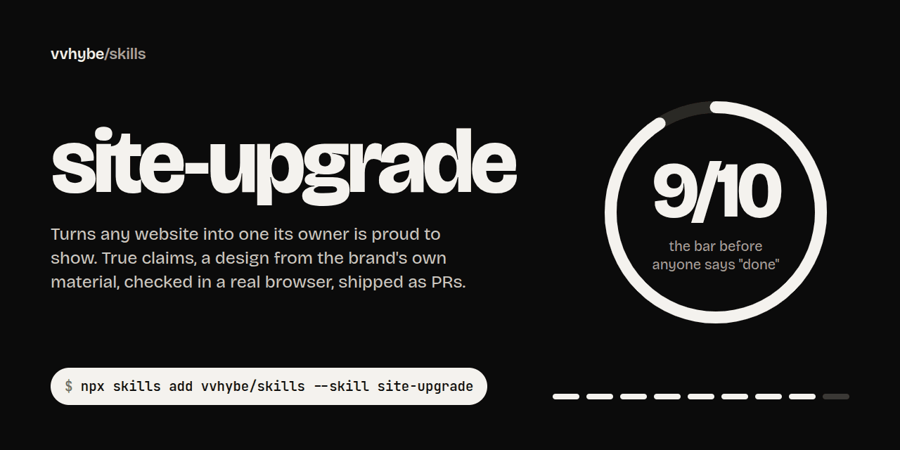
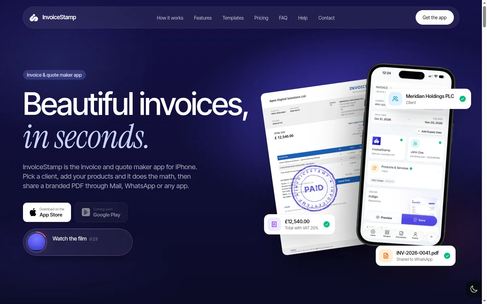
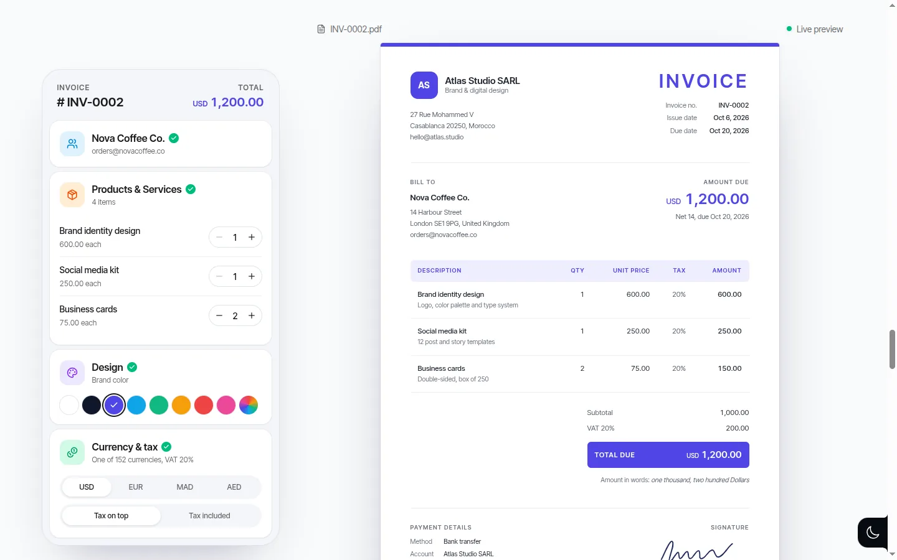
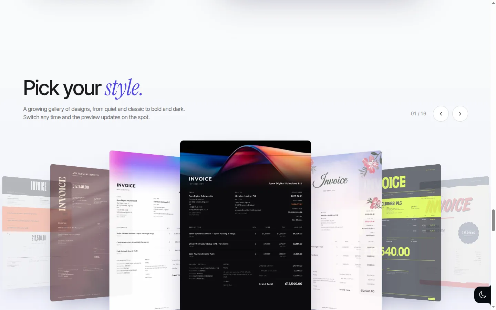
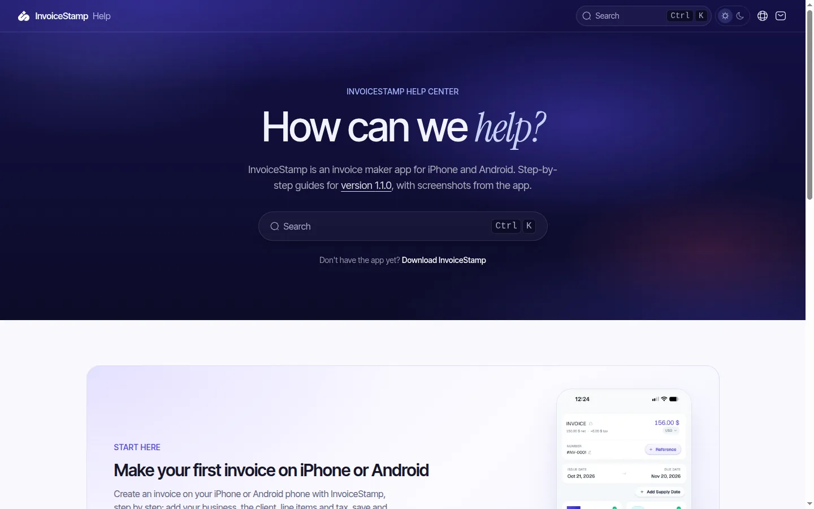
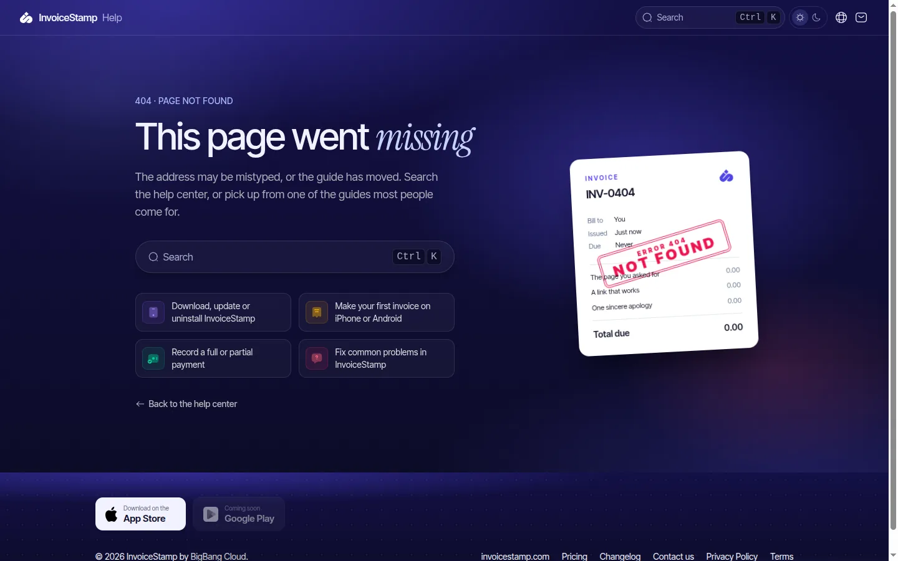
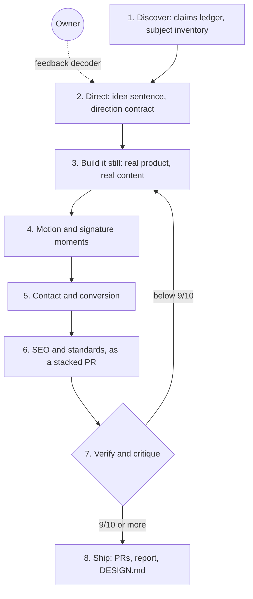

<p align="center">
  
</p>

<p align="center">
  <a href="https://github.com/vvhybe/skills/actions/workflows/check.yml"></a>
  <a href="LICENSE"></a>
  <a href="https://agentskills.io"></a>
  <a href="#install"></a>
  <a href="CHANGELOG.md"></a>
</p>

# vvhybe/skills

Agent skills for shipping real work, end to end:

- **[site-upgrade](#site-upgrade)** turns a website into one its owner is proud to show.
- **[dev-guide](#dev-guide)** writes a developer guide for any repository and typesets it as a real book.

## site-upgrade

Most design skills teach an agent taste. **site-upgrade** teaches it the whole job a senior design engineer does when a company says *"make our website premium"*:

1. find out what's actually **true** about the product before writing a word,
2. design from the **brand's own material**, not from the category's defaults,
3. build the one or two **moments** visitors remember, with the real product as the hero,
4. make the contact form **actually reach someone**,
5. ship **SEO, social cards and security headers** as their own PR,
6. **look at every screen** at four widths, in every theme, with reduced motion, on a production build,
7. **score it honestly** and refuse to say "done" below 9/10,
8. and hand over **PRs the team can review**, with an update they can paste.

It wasn't written from theory. It was distilled from real sites that shipped, and from every reaction their owners had along the way, including the ones that started with *"not the kind of spice I'm looking for"*.

## Built with it

### InvoiceStamp, an invoicing app's site

*On this site, the stamp in the name becomes an ink seal that slams onto a real invoice.*

<p>
  <a href="https://invoicestamp.com"></a>
</p>

<table>
  <tr>
    <td width="50%"></td>
    <td width="50%"></td>
  </tr>
  <tr>
    <td><sub><b>A live invoice.</b> Edit the quantities; only the values that changed flash, and the totals tween.</sub></td>
    <td><sub><b>Real outputs, not an image grid.</b> A coverflow of actual rendered templates.</sub></td>
  </tr>
</table>

<sub>Earned exceptions, named in its direction contract: the indigo and the italic serif accent look like generated-site defaults, but both come from the app's own UI and its product reel's titles.</sub>

[Read the case study →](docs/case-studies/invoicestamp.md)

### InvoiceStamp Help Center, built from nothing

*A help center in the product's own language: every guide tied to a real screen, every topic in the app's own icons and tones.*

<table>
  <tr>
    <td width="50%"><a href="https://help.invoicestamp.com"></a></td>
    <td width="50%"></td>
  </tr>
  <tr>
    <td><sub><b>The brand owns the frame,</b> the reading column stays calm.</sub></td>
    <td><sub><b>The 404 is an invoice:</b> INV-0404, due "never", stamped NOT FOUND.</sub></td>
  </tr>
</table>

[Read the case study →](docs/case-studies/help-center.md)

### BigBang Cloud, one company and two complete directions

A B2B private cloud for ERP systems, taken from a template through a "ground control" direction with a mascot rendered from the owner's own 3D model of the logo, then through a corporate direction with problem-to-answer illustrations, an honest comparison with the hyperscalers and a catalog that turns into qualified leads. *Screenshots arrive when the new site is live on its domain.*

[Read the case study →](docs/case-studies/bigbang-cloud.md)

## What makes it different

| Idea | In practice |
| --- | --- |
| **Truth before design** | A claims ledger (shipped, not shipped, unknown, numbers with their source) is filled before anything is designed. Invented proof, unsourced uptime figures and "join 10,000+ teams" never make it to the page; unknown figures leave an optional slot and a fact-check form for whoever can answer. |
| **The brand decides the look** | An idea sentence (*"On this site, X becomes Y"*) taken from what only this company has, tested by putting the nearest competitor's name in it. Palette by color theory, sampled from the brand's own material. |
| **Tells, with earned exceptions** | A dated registry of what makes a site read as generated. Unlike a ban list, a tell is allowed when the brand itself puts it there, and the exception has to be named with its reason. |
| **Three modes** | Persuade (product and company sites), Read (help centers, docs, changelogs) and Experience (portfolios) each get their own rules. A help center is not a landing page. |
| **The 9/10 rule** | A written, scored critique from screenshots, weighted like an awards jury, with caps that stop a pretty page from hiding a blank band or an invented claim. Up to three rounds; scores below 9 are reported, never rounded up. |
| **A feedback decoder** | What owners actually say ("it feels like PowerPoint", "colors out of balance", "cheap replica", "all indigo is boring") mapped to what to change. |
| **It ships like an engineer** | A contact route with bot checks and a designed team email, SEO and standards as a stacked PR, CSP and security headers, a before/after report, a `DESIGN.md` for the next agent, and PRs with a paste-ready team update. |
| **3D when it earns it** | When a mascot or an object carries the idea: the owner's own model first, procedural reconstruction second, an exactness gate, and a headless Blender to glTF pipeline. |

## How it works



The method works on any stack; the recipes and snippets come from where they shipped (Next.js, React, Tailwind, GSAP, Cloudflare Pages), so they're Next.js-first. The agent reads one reference file per phase, only when it gets there, so the skill stays light in context: [`SKILL.md`](skills/site-upgrade/SKILL.md) is the map, and [`references/`](skills/site-upgrade/references) holds the detail.

## Install

**Any agent that reads Agent Skills** (Claude Code, Codex, Cursor, Gemini CLI and others), with the [`skills` CLI](https://github.com/vercel-labs/skills):

```bash
npx skills add vvhybe/skills --skill site-upgrade
```

<details>
<summary><b>Claude Code plugin</b></summary>

```
/plugin marketplace add vvhybe/skills
/plugin install site-upgrade@vvhybe
```

</details>

<details>
<summary><b>From a clone, linked so <code>git pull</code> updates it</b></summary>

```bash
git clone https://github.com/vvhybe/skills.git ~/src/vvhybe-skills
ln -s ~/src/vvhybe-skills/skills/site-upgrade ~/.claude/skills/site-upgrade
```

</details>

The scripts need Node 18+ and, for the browser checks, the Playwright MCP server. Nothing else is installed.

## Use it

Ask in your own words; the skill triggers on requests like these:

```text
Spice up our marketing site. It still looks like the template we bought.
The app's repo is ../app and there's a product video in assets/reel.mp4.
```

```text
We need a help center for the app at help.example.com. Ground every guide in the real screens.
```

```text
The owner says it "feels like PowerPoint, not a website". Fix that.
```

```text
Run an SEO, Open Graph and security headers pass on the site, as its own PR.
```

## The tools

Every check the skill relies on is a script you can run yourself.

**`slop-scan.mjs`** scans source for generated-site tells, invented proof, genre copy, dead links, secrets and known traps. Zero dependencies. Earned exceptions are named, never silent.

```text
$ node skills/site-upgrade/scripts/slop-scan.mjs tests/fixtures/sloppy-site
slop-scan: 2 files in tests/fixtures/sloppy-site: 4 error(s), 22 warning(s)

ERROR invented-proof  Social proof that needs a source (2)
  index.html:15  <p>Join 10,000+ teams · Fast · Secure · Simple</p>
  index.html:24  <blockquote>★★★★★ "Acme changed everything." John Doe, CEO of Acme Inc</blockquote>
  → Real proof with a source in the claims ledger, or none.

WARN  gradient-text  Gradient-filled text (1)
  index.html:12  …from-indigo-500 to-violet-500 bg-clip-text text-transparent">Unlock your potential</h1>
  → Solid ink; emphasis from size or weight.
…
```

**`ssr-audit.sh`** proves pages are really server-rendered and carry their SEO basics, then checks headers and crawler files. Here it is on a site built with the skill:

```text
$ ./ssr-audit.sh https://invoicestamp.com / /faq /pricing /contact-us
PATH                         CODE  H1  LD CANON  OG      CSR   BYTES  TITLE
/                             200   1   3   yes yes       ok  200358  InvoiceStamp: Invoice & Quote Maker App for Small Busine
/faq                          200   1   4   yes yes       ok  162672  FAQ: Invoices, Templates, Tax & Billing - InvoiceStamp
/pricing                      200   1   4   yes yes       ok  107334  Pricing: $12.99 a month or $119.99 a year - InvoiceStamp
/contact-us                   200   1   3   yes yes       ok   87699  Contact Us - InvoiceStamp

== headers on https://invoicestamp.com/
  ok    strict-transport-security: max-age=31536000
  ok    content-security-policy: default-src 'self'; script-src 'self' 'unsafe-inline' …
  ok    x-content-type-options: nosniff
  …
all pages pass
```

**In the browser** (through the Playwright MCP): `page-audit.js` measures the frame (one `<h1>`, headlines within two lines, small text, tap targets, unnamed controls, untitled sections, unthemed browser surfaces), `overflow.js` names what causes sideways scroll from 320 to 1440 px, `reveal-scroll.js` finds content a reveal never showed, and `console-scan.js` walks the sitemap for errors and CSP violations. **`video-prep.sh`** turns a product reel into silent web encodes with keyframes at every scene cut, a poster and a square preview clip.

## What's in the box

```text
skills/site-upgrade/
├── SKILL.md                  the map: rules, modes, phases, checkpoints
├── references/               read one per phase
│   ├── discovery.md          truth sources, claims ledger, subject inventory
│   ├── direction.md          the idea, color theory, type, acts, signature, two directions
│   ├── tells.md              what reads as generated, and earned exceptions
│   ├── building-blocks.md    heroes, scroll stories, live demos, B2B blocks, pricing, inner pages
│   ├── motion.md             the motion budget, recipes, reduced motion
│   ├── three-d.md            3D mascots and objects, from source model to runtime
│   ├── media.md              video, images, device frames, logos, QR codes, protected assets
│   ├── read-mode.md          help centers, docs and changelogs
│   ├── contact-email.md      the form, the route, bot checks, the team email, booking
│   ├── seo-standards.md      rendering, metadata, social cards, JSON-LD, headers, static exports
│   ├── verification.md       the browser loop and the scripted checks
│   ├── critique.md           the scored critique and the 9/10 rule
│   ├── delivery.md           PRs, team update, before/after report, DESIGN.md
│   ├── feedback.md           what owners say, and what to change
│   └── gotchas.md            traps hit on real sites, with fixes
├── scripts/                  slop-scan, ssr-audit, video-prep, Playwright checks
├── assets/                   email renderer, JSON-LD tag, scroll refresh, templates
└── evals/                    prompts and expectations for testing the skill
```

## dev-guide

Most generated documentation is a pile of pages. **dev-guide** writes a *book*: a guided tour of a codebase for a capable developer who has never seen it, checked fact by fact against the code, then typeset as a PDF and a Word file that look like they came from a publisher.

- **Linked Markdown first.** `docs/guide/` reads on GitHub or in Obsidian: four parts, chapters that open with what they cover and close with questions that check understanding, callouts, Mermaid diagrams and a glossary.
- **Every fact has a source.** Each claim traces to a `path:line`, and each number to a command that is re-run before it goes on a page.
- **Covers like a real technical series.** One public-domain engraving tied to the subject (a botanical woodcut, an 1819 printing-press plate, a plate from Diderot's *Encyclopédie*), printed in one ink above a panel in the volume's colour and set in EB Garamond. `find_plate.py` searches open collections and records each plate's credit, which prints on the back cover.
- **Series.** Sibling repositories become Volume I, II and III of one set.
- **Both editions match.** The PDF, the Word file and a cover thumbnail come from one build, with free software only (WeasyPrint and poppler).
- **Safe on any repository.** Raw HTML in the pages is cleaned, and the PDF engine can read only the guide, never the network.

```bash
npx skills add vvhybe/skills --skill dev-guide
```

```text
Write a developer guide for this repository so new engineers can onboard, and give us a printable PDF.
```

It learned from [Diátaxis](https://diataxis.fr) (what kind of documentation a guide is), from the long tradition of engraved covers on technical books, and from open collections such as [Wikimedia Commons](https://commons.wikimedia.org) and the [Art Institute of Chicago](https://www.artic.edu/open-access) that put public-domain plates within reach.

## Standing on shoulders

site-upgrade learned from the best open design skills and credits them gladly. If you have them installed, it uses them in the direction phase.

- [**taste-skill**](https://github.com/Leonxlnx/taste-skill) by Leonxlnx: the subject inventory, the competitor test, the "one live thing", the scored critique with caps, and the dated registry of tells.
- [**impeccable**](https://github.com/pbakaus/impeccable) by Paul Bakaus: surface modes, the craft floor (browser surfaces are part of the design), the direction contract, and calibrating against the looks generated sites cluster around.
- [**awesome-design-md**](https://github.com/VoltAgent/awesome-design-md) by VoltAgent: the `DESIGN.md` format the skill writes at the end so the next agent stays on brand.
- [**img2threejs**](https://github.com/img2threejs/img2threejs): procedural Three.js reconstruction from a reference image, the second rung of the 3D source ladder.
- [**claude-seo**](https://github.com/AgriciDaniel/claude-seo) by AgriciDaniel: current search guidance the SEO phase defers to.

Where those skills focus on the page, site-upgrade wraps the whole engagement around it: truth, conversion, standards, verification and delivery. The two skills share their rules: real material over decoration, every claim sourced, and verification before anyone says "done".

## Contributing

The best contribution is a [field report](https://github.com/vvhybe/skills/issues/new?template=field-report.yml): you ran the skill on a real site, and here's what the owner said. Rules here come from shipped work, so evidence beats opinion. See [CONTRIBUTING.md](CONTRIBUTING.md).

## License

[MIT](LICENSE) © [vvhybe](https://github.com/vvhybe)
