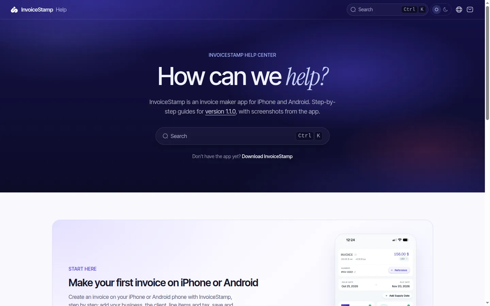
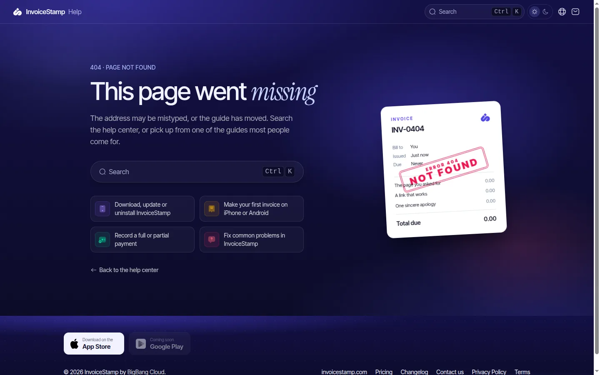
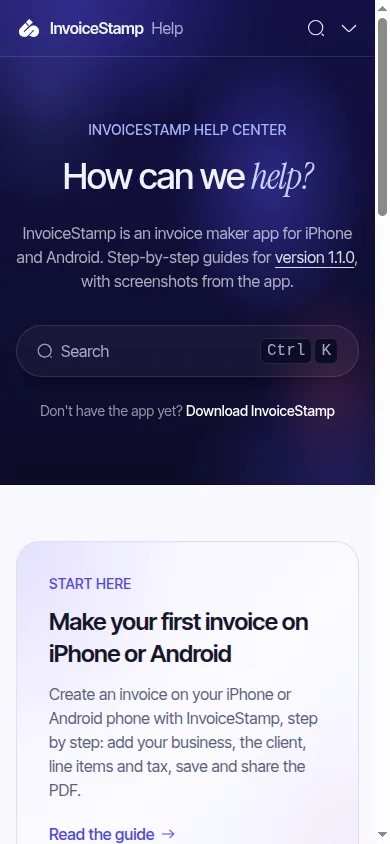

# InvoiceStamp Help Center: a help center in the product's own language

**[help.invoicestamp.com](https://help.invoicestamp.com)** · guides for the InvoiceStamp app · Read mode

  

## The brief

A help center built from nothing, from the app's screenshots and its code, that "relates to each screen" instead of generic how-to text, and that belongs to the same brand as the marketing site.

## What the skill did

**Know the app, not the feel.** Every guide was written from the app's code at its release tag and its real screens.

**The brand owns the frame, not the column.** The header, the hero, the 404 and the way callouts are set carry the site's deep indigo and its type; the reading column stays calm, with real contrast and a real measure.

**The product's own icons.** The first pass put the same indigo chip on every topic. The owner: *"all indigo is boring, the average purple AI style."* Each topic now wears the icon the app uses for the same screen, in the app's own tones, from the app's own icon library.

**A 404 in the product's language.** An invoice numbered INV-0404, issued "just now", due "never", with a NOT FOUND stamp landing on it, plus the guides most people come for.

  

**Readers' tools.** Hard terms (tax ID, unit price, unit of measure) open as inline definitions instead of sending readers to a glossary page. Every guide asks "was this helpful?". Every page also exists as Markdown, listed in `llms.txt`, with an MCP endpoint and an "Ask AI" entry, so assistants can answer from the same guides.

**Getting the app, done properly.** Store badges styled like the marketing site's, and in the download guide a large QR code with the store's logo inside the code itself. The first version pasted a logo over the code; the owner called it a *"cheap trick"*. The final one clears whole modules, uses high error correction and is verified to scan.

**One source for the app too.** The same guides are served to the app as a versioned JSON contract, so in-app help and the website never drift apart.

## Decisions worth copying

- **help., not docs.** A consumer app's readers aren't developers. The old host redirects every path to the same path on the new one.
- **Its own repo,** because the docs framework needed newer framework versions than the marketing site.
- **One set of guides for both phones** when the layouts are the same.
- **Latest only.** The app nudges people to update, so the guides describe the current version and say which one.

## What it taught the skill

- A whole new mode, Read, with its own rules → [`read-mode.md`](../../skills/site-upgrade/references/read-mode.md)
- "Cheap trick" and "average purple AI" in the feedback decoder → [`feedback.md`](../../skills/site-upgrade/references/feedback.md)
- QR codes with a logo, and brand logos from a CDN → [`media.md`](../../skills/site-upgrade/references/media.md)
