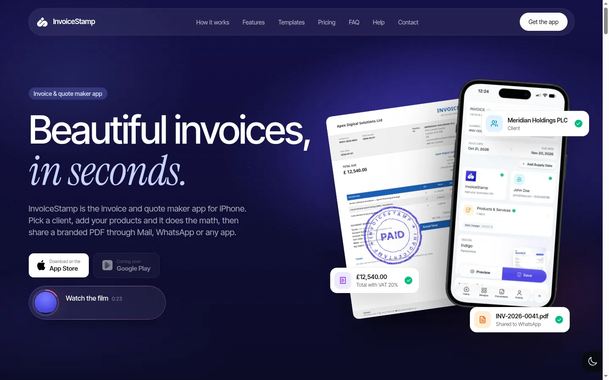
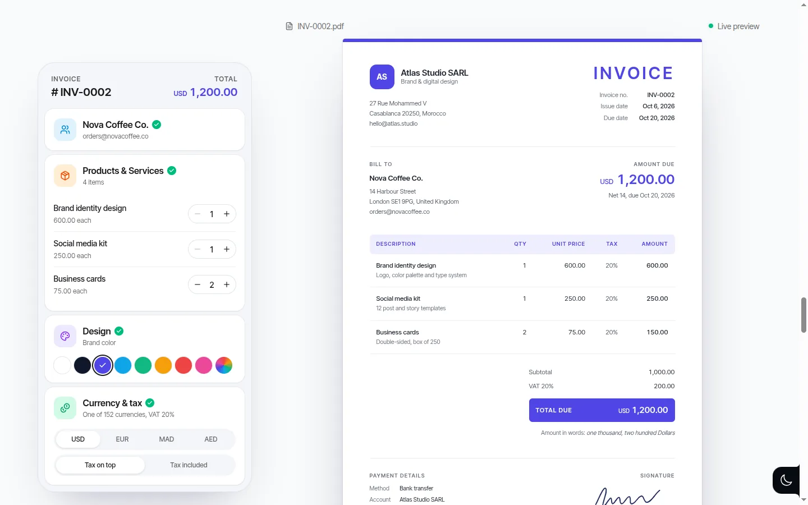
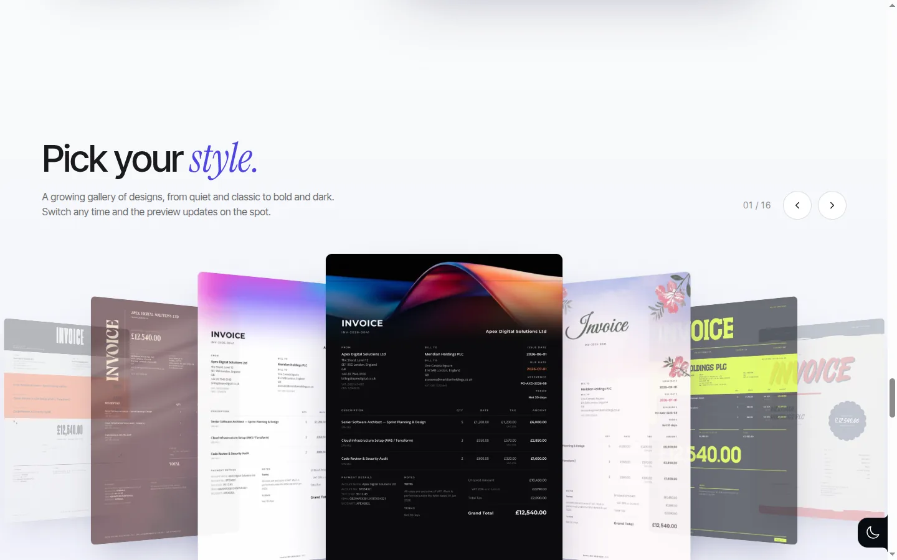

# InvoiceStamp: from a bought template to a site that shows the product

**[invoicestamp.com](https://invoicestamp.com)** · an invoice and quote maker app for small businesses · Persuade mode

  

## Where it started

The site was a SaaS template with the app's name dropped in: centered blocks that each faded in, a "Watch in 23 seconds" pill over a video, generic feature cards, and template copy. The owner's verdict on the first pass, which only added the product video, set the bar for the whole project:

> "Not enough spice. It's just 'we added a video'. The website still doesn't feel premium. It doesn't make the app shine, and it's more PowerPoint than a website."

## What the skill did

**Truth first.** Every feature on the page was checked against the app's code at its release tag; anything the code didn't confirm stayed off. Counts (currencies, templates) are read from data files, and prices come from the billing system at build time, so the site and the app can't disagree.

**The idea.** *On this site, the stamp in the name becomes an ink seal that slams onto a real invoice.* The hero's intro ends with the seal landing on an A4 page, with a page jolt and an ink ring. When the contact form sends, the success screen is stamped "SENT".

**The product as the hero.** No icons standing in for features:

| | |
| --- | --- |
|  |  |
| **A live invoice.** An editor styled like the real app beside a real A4 document. Change a quantity and only the values that changed flash; totals tween. | **Real templates.** A coverflow of actual rendered invoices, with the library's counts as floating cards that count up. |

**A story that moves on its own.** The product reel became a pinned scroll story: each chapter plays its own range of one video, progress bars are equal length like stories, and a chapter hands over to the next when the visitor lingers. On phones it becomes a full-screen reel with captions that cycle like a news ticker.

**A crafted call to action.** "Watch in 23 seconds" became a live preview capsule: a silent square clip in a circle, a progress ring driven by the clip's time, and the current chapter's caption. The owner's words: they wanted "#upgrade, not #update".

**A contact form that really delivers.** Shared validation, a honeypot and timing check, an edge route that sends through Cloudflare Email Service, fixed `Website:` subjects so the team can filter, and a designed React Email notification with a reply button and a triage panel.

**SEO and standards as a stacked PR.** The template had wrapped the layout in a `Suspense` around `useSearchParams()`, so every page shipped a "Loading..." shell to crawlers. Fixing that came first; then metadata per page, prerendered social cards, a linked JSON-LD graph, crawler files, security headers and a CSP, and IndexNow.

## What it taught the skill

- "Not enough spice" means more product, interaction and depth, never more decoration → [`feedback.md`](../../skills/site-upgrade/references/feedback.md)
- Check every feature claim in the product's code → [`discovery.md`](../../skills/site-upgrade/references/discovery.md)
- Demos should be the real artifact (a real A4 invoice), and a "changed" flash must track each value → [`building-blocks.md`](../../skills/site-upgrade/references/building-blocks.md)
- Configuration holds values, never on/off switches (store URLs as env values; empty means "Coming soon")
- Ship SEO as its own stacked PR, and fix server rendering before anything else → [`seo-standards.md`](../../skills/site-upgrade/references/seo-standards.md)
