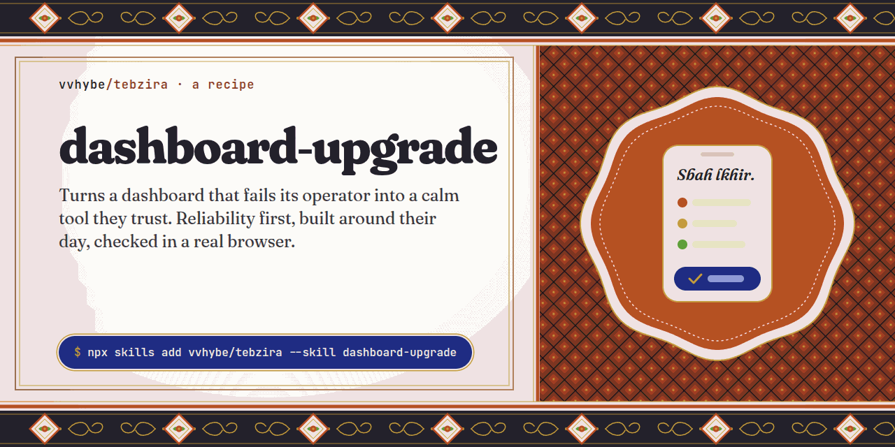
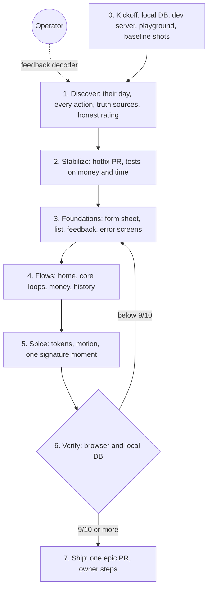

<p align="center">
  
</p>

<p align="center">
  <a href="https://github.com/vvhybe/tebzira/actions/workflows/check.yml"></a>
  <a href="../../LICENSE"></a>
  <a href="https://agentskills.io"></a>
  <a href="#install"></a>
  <a href="../../CHANGELOG.md"></a>
</p>

# dashboard-upgrade

<sub>A recipe from [tebzira](../../README.md), the blend of agent skills I use in my own work.</sub>

A dashboard is not a website. Nobody visits it; one person lives in it. They take payments in it at the door, look up a client between two appointments, and close the month in it on a laptop. When it loses a payment or forgets a half-typed form, no amount of polish makes it premium.

**dashboard-upgrade** teaches an agent to upgrade a back office the way that person needs:

1. map the **operator's real day**: their device, their moments, their words,
2. fix the **broken actions and money bugs first**, with tests, before touching the look,
3. build the **shared foundations** once (a form that never loses input, a list that works on a phone, an error the operator can report) and move every screen onto them,
4. reshape the screens **around their tasks**, not around the database tables,
5. add **one signature moment** where they aren't working: sign-in, the greeting, an empty screen,
6. **check every action for real**, in a browser at phone and desktop widths and against a local copy of the database,
7. refuse to say **"done" below 9/10**,
8. and ship **one epic PR**, with production steps left to the owner.

## Built with it

### A yoga studio's command center, in Marrakech

One instructor runs the studio, mostly from a phone at the door and between classes: check-ins, class cards, payments, partner billing at the end of the month. The dashboard had grown feature by feature. Payments failed on one enum value missing in production, forms lived in dialogs that closed on a stray tap, screens had their own tables and, in places, their own idea of what a client owed.

The epic fixed production first in its own hotfix PR, then put the money logic under tests, then rebuilt the app on one form sheet, one data table and one feedback system, reshaped home around the instructor's day (greeted by name, in the studio's time zone), and gave the sign-in and error screens one signature scene: a lotus pond at dawn, drawn from the logo's own petals.

The source is public at **[jnaninyoga/dashboard](https://github.com/jnaninyoga/dashboard)**. Every `Ref:` path in this skill's references points at a real file there, so the agent can read how a pattern was built rather than imagine it.

## What makes it different

| Idea | In practice |
| --- | --- |
| **Reliability before spice** | The order of work is fixed: data and action bugs with tests, then shared foundations, then flows, then design. A broken payment is a hotfix PR before anything else. |
| **One operator, not a generic admin** | Discovery maps a real day: who, on what device, at which moments, doing what. No KPI-tile walls, no settings pages nobody opens, the operator's words on every button. |
| **Never lose input** | Create and edit happen in a sheet on desktop and a drawer on phones that asks before discarding. Never a dialog that closes on an outside click. |
| **Every action answers** | Success or failure is always visible. A failure carries a short code that matches a server log line, and a report the operator can send to the developer in one tap. |
| **One number, one truth** | Each figure comes from one domain module and reads the same everywhere. Money in integer cents, a decimal comma accepted, dates in the business's time zone. |
| **Facts, not just pixels** | An action harness runs the app's real server actions against the local database without Next.js, to prove the rows a payment writes and the balance a split payment leaves. |
| **The 9/10 rule** | Screens are scored from screenshots on hierarchy, redundancy, alignment, affordance, type, density and fit to the operator's day, and fixed before anyone calls them done. |
| **Production is the owner's** | Never queries or migrates the live database; migrations, env vars and deploys are listed as owner steps. |

## How it works



The method works on any stack; the recipes and snippets come from where it shipped (Next.js, Drizzle, Postgres, shadcn/ui), so they're Next.js-first. [`SKILL.md`](SKILL.md) is the map, and [`references/`](references) holds one file per phase, read only when the agent gets there.

## Install

**Any agent that reads Agent Skills** (Claude Code, Codex, Cursor, Gemini CLI and others), with the [`skills` CLI](https://github.com/vercel-labs/skills):

```bash
npx skills add vvhybe/tebzira --skill dashboard-upgrade
```

<details>
<summary><b>Claude Code plugin</b></summary>

```
/plugin marketplace add vvhybe/tebzira
/plugin install dashboard-upgrade@tebzira
```

</details>

<details>
<summary><b>From a clone, linked so <code>git pull</code> updates it</b></summary>

```bash
git clone https://github.com/vvhybe/tebzira.git ~/src/tebzira
ln -s ~/src/tebzira/skills/dashboard-upgrade ~/.claude/skills/dashboard-upgrade
```

</details>

The browser checks need the Playwright MCP server; the action harness needs `tsx` and a local database. Nothing else is installed.

## Use it

Ask in your own words; the skill triggers on requests like these:

```text
Our admin dashboard is a mess: payments sometimes fail, forms lose what I typed,
and it's ugly on my phone. Spice it up and make it premium.
```

```text
The create-client dialog closes when I tap outside and I lose everything. Fix it across the app.
```

```text
A payment fails with "Something went wrong" and I can't tell you why. Make errors useful.
```

```text
The owner says the back office "feels generic". Make it theirs.
```

## The tools

**In the browser** (through the Playwright MCP):

- `covered-controls.js` lists buttons, links and menu triggers whose centre is covered by another element: the "⋮" menu that does nothing because a card sits on top of it.
- `tap-targets.js` lists, at phone width, controls smaller than 40×40 px and visible text under 12 px.
- `overflow.js` finds what makes the page scroll sideways from 320 to 1440 px and names the outermost culprit.

**Against the database:** `assets/action-harness/` runs real server actions and domain code against the local database with `tsx`, stubbing `next/cache` and the session check. It proves what a screenshot can't: the rows a save wrote, the balance after a split payment, whether a double tap creates two payments.

**When the dev server won't fit:** `assets/static-preview.tsx` renders one presentational component to static HTML with the app's own tokens, for a visual check on a small machine.

## What's in the box

```text
dashboard-upgrade/
├── SKILL.md                  the map: rules, phases, owner checkpoints
├── references/               read one per phase
│   ├── discovery.md          the operator's day, the action audit, truth sources, the honest rating
│   ├── foundations.md        form sheet, data table, row actions, feedback, money, playground
│   ├── flows.md              home, core loops, history, money flows, navigation, sign-in
│   ├── design-direction.md   identity, calm motion, signature moments, libraries that behave
│   ├── verification.md       local environment, browser loop, facts not pixels
│   ├── delivery.md           hotfix and epic PRs, owner updates, memory
│   ├── feedback.md           what owners say, and what to change
│   └── gotchas.md            traps hit on a real dashboard, with fixes
├── scripts/playwright/       covered-controls, tap-targets, overflow
├── assets/                   action harness, static preview
└── evals/                    prompts and expectations for testing the skill
```

## Standing on shoulders

dashboard-upgrade doesn't teach taste on its own terms; it leaves that to the best design skills. If one is installed ([**impeccable**](https://github.com/pbakaus/impeccable), [**taste-skill**](https://github.com/Leonxlnx/taste-skill) or Anthropic's `frontend-design`), it loads it in the spice phase. It also shares its 9/10 rule and its feedback decoder with its sibling, [site-upgrade](../site-upgrade/README.md).

## Contributing

The best contribution is a [field report](https://github.com/vvhybe/tebzira/issues/new?template=field-report.yml): you ran the skill on a real back office, and here's what its operator said. See [CONTRIBUTING.md](../../CONTRIBUTING.md).

## License

[MIT](../../LICENSE) © [vvhybe](https://github.com/vvhybe)
