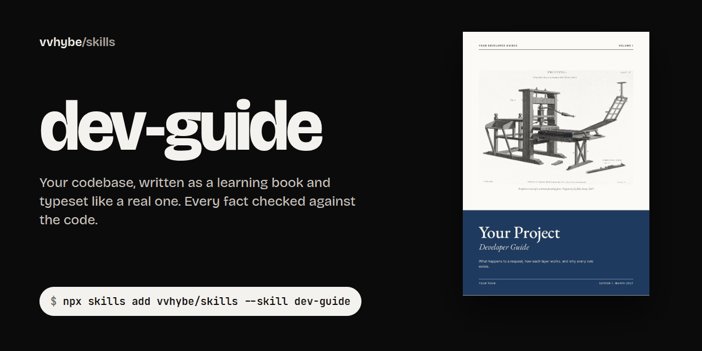
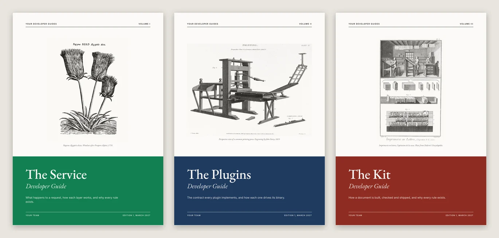
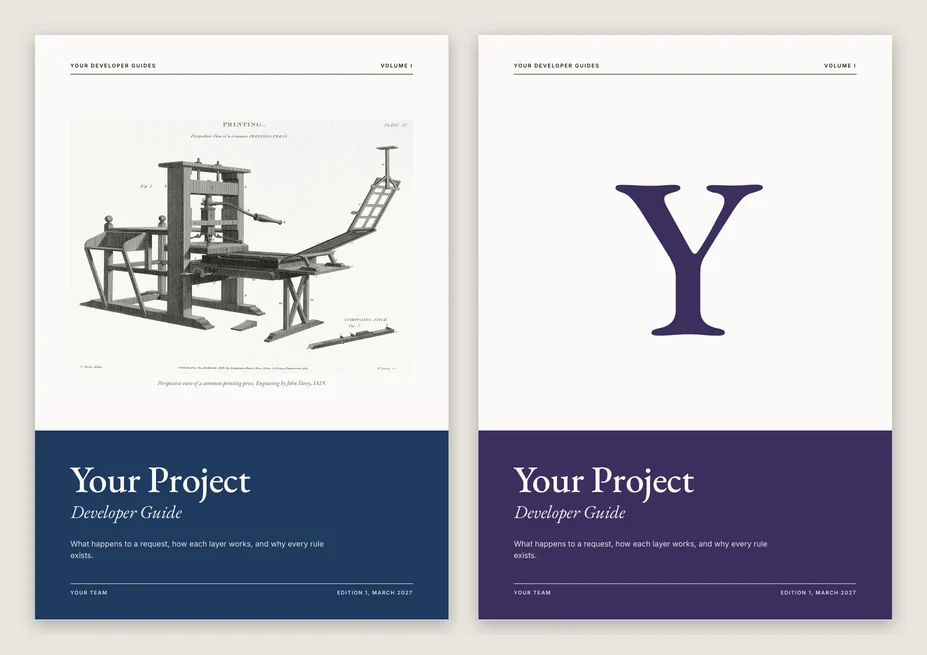
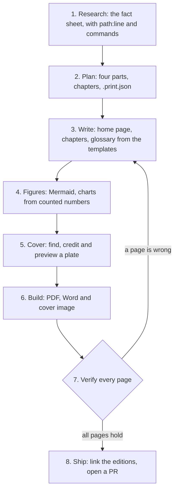

<p align="center">
  
</p>

<p align="center">
  <a href="https://github.com/vvhybe/skills/actions/workflows/check.yml"></a>
  <a href="../../LICENSE"></a>
  <a href="https://agentskills.io"></a>
  <a href="#install"></a>
  <a href="../../CHANGELOG.md"></a>
</p>

# dev-guide

<sub>Part of [vvhybe/skills](../../README.md), the agent skills I use in my own work.</sub>

Most generated documentation is a pile of pages. **dev-guide** writes a *book*: a guided tour of a codebase for a capable developer who has never seen it, checked fact by fact against the code, then typeset as a PDF and a Word file that look like they came from a publisher.

1. **research** the repository into a fact sheet, where every claim has a `path:line` and every number a command,
2. **plan** four parts that take a newcomer from the big picture to running it day to day,
3. **write** chapters that open with what they cover, explain why each rule exists, and close with questions that check understanding,
4. **draw** the shape of things in Mermaid, and chart only numbers that were counted,
5. **find a cover plate**, a real public-domain engraving tied to the subject, and record its credit,
6. **build** the PDF, the Word file and a cover image from the same Markdown,
7. and **verify** every page by eye before anyone calls it done.

It wasn't written from theory either. It was built on three related production repositories (a rendering service, its PDF engine plugins and its template kit), whose guides became Volumes I, II and III of one series.

## The cover

The cover is the guide's thumbnail: the first page of the PDF, the Word file's first page, the image in the README. Professional technical series all make the same few decisions (one real picture, a series grid, classic type, one colour per volume), and dev-guide builds exactly that.

<p>
  
</p>

<sub><b>From scan to cover.</b> An 1819 engraving from an open collection, as scanned; the same plate after <code>make_cover.py</code> maps its old paper to the cover's paper and prints it in one ink; the finished cover. The credit prints on the back cover.</sub>

<table>
  <tr>
    <td width="62%"></td>
    <td width="38%"></td>
  </tr>
  <tr>
    <td><sub><b>A series.</b> Sibling repositories become volumes: same grid, one plate and one colour each, plates from one family of subjects.</sub></td>
    <td><sub><b>Two styles.</b> A plate, or a single large letter when no plate fits.</sub></td>
  </tr>
</table>

<sub>Sample covers for a placeholder project, rendered by the skill. The plates are public domain: a 1735 woodcut after Prospero Alpini, John Farey's 1819 printing press, and a plate from Diderot's <i>Encyclopédie</i>.</sub>

## What makes it different

| Idea | In practice |
| --- | --- |
| **Every fact has a source** | A fact sheet comes before the first chapter: each claim traces to a `path:line`, each number to a command, and numbers are re-counted right before they go on a page. What the code doesn't confirm doesn't get written. |
| **A learning book, not a reference dump** | Mostly explanation, shaped like a tutorial, ending in a little reference (the Diátaxis framework). Every chapter opens with what it covers, gives the reason behind each rule, and ends with questions whose answers teach. |
| **Markdown first** | `docs/guide/` reads on GitHub or in Obsidian: GitHub alerts become five kinds of callout, Mermaid becomes figures, and the books are builds, never edited by hand. |
| **Publisher-grade covers** | A public-domain plate found in open collections (`find_plate.py`), cleaned and printed in one ink (`make_cover.py`), set in EB Garamond above a panel in the volume's colour. Never stock illustration, never a publisher's trade dress. |
| **Both editions match** | One build makes the PDF, the Word file (fonts embedded, contents page filled) and the cover image, with free software only: WeasyPrint and poppler. |
| **Safe on any repository** | Pages may come from a repository you don't control: one allowlist pass over the finished book, a renderer that can read only the guide, outputs confined to the repo. A test proves a hostile page can't embed a local file. |

## How it works



[`SKILL.md`](SKILL.md) is the map; [`references/`](references) holds the detail, read one file per step: research, writing, the cover, and building and verifying.

## Install

**Any agent that reads Agent Skills** (Claude Code, Codex, Cursor, Gemini CLI and others), with the [`skills` CLI](https://github.com/vercel-labs/skills):

```bash
npx skills add vvhybe/skills --skill dev-guide
```

<details>
<summary><b>Claude Code plugin</b></summary>

```
/plugin marketplace add vvhybe/skills
/plugin install dev-guide@vvhybe
```

</details>

<details>
<summary><b>From a clone, linked so <code>git pull</code> updates it</b></summary>

```bash
git clone https://github.com/vvhybe/skills.git ~/src/vvhybe-skills
ln -s ~/src/vvhybe-skills/skills/dev-guide ~/.claude/skills/dev-guide
```

</details>

The build needs Python 3.10+ (it makes its own venv), Node 18+ with [mermaid-cli](https://github.com/mermaid-js/mermaid-cli), and poppler. LibreOffice is optional (it fills the Word contents page). PrinceXML is optional; WeasyPrint is the default.

## Use it

```text
Write a developer guide for this repository so new engineers can onboard, and give us a printable PDF.
```

```text
Our three repos (the service, its plugins and its SDK) need guides that feel like one set.
```

```text
The guide's cover looks like clip art. Make it look like a real developer book.
```

## The tools

**`build.sh`** turns the pages into the books, in about a minute for 50 pages. Here it is on a small project scaffolded from the templates:

```text
$ bash skills/dev-guide/scripts/build.sh docs/guide/.print.json
chapters: 5 diagrams: 1
PDF:  docs/acme-api-developer-guide.pdf (13 pages)
Cover: docs/acme-api-developer-guide-cover.png
Word: docs/acme-api-developer-guide.docx
```

**`find_plate.py`** searches open collections for public-domain plates, keeps only public-domain and CC0 files, writes a contact sheet to look at, and downloads the chosen one with its credit:

```text
$ python find_plate.py "printing press engraving" --sheet press.png
[3] commons:File:Printing_press.jpg
     Printing press — John Farey 1819
     Public domain 3000×2219  https://commons.wikimedia.org/wiki/File:Printing_press.jpg
$ python find_plate.py --get commons:File:Printing_press.jpg --out docs/guide/assets/plate
saved docs/guide/assets/plate/printing-press.jpg
credit: Printing press, John Farey, 1819. Wikimedia Commons, Public domain.
```

**`make_cover.py --preview`** renders the cover alone in seconds while you iterate. **`contact_sheet.py`** tiles every page of a PDF for review, and **`diagram_sizes.py`** lists diagrams whose printed text would be too small.

## What's in the box

```text
dev-guide/
├── SKILL.md                  the map: rules, steps, scripts, checkpoints
├── references/
│   ├── research.md           the fact sheet: sources, counting, agents
│   ├── writing.md            Diátaxis, the four parts, chapter anatomy, callouts, quizzes, diagrams
│   ├── cover.md              how technical covers work; finding, treating and crediting a plate; series
│   └── build.md              requirements, build, verify, ship, safety, gotchas
├── scripts/                  build.sh, find_plate, make_cover, safe_html, render_pdf, Word builder, checks
├── assets/                   book.css, fonts with their licences, Mermaid theme, templates
└── evals/                    prompts and expectations for testing the skill
```

## Standing on shoulders

- [**Diátaxis**](https://diataxis.fr) by Daniele Procida: what kind of documentation a developer guide is.
- The long tradition of engraved covers on technical books, from which the series system takes its discipline (and none of any one publisher's trade dress).
- [**Wikimedia Commons**](https://commons.wikimedia.org) and the [**Art Institute of Chicago**](https://www.artic.edu/open-access), whose open collections put public-domain plates within reach.
- [**WeasyPrint**](https://weasyprint.org), [**docx**](https://docx.js.org), [**Mermaid**](https://mermaid.js.org), and the [**EB Garamond**](https://github.com/octaviopardo/EBGaramond12), [**Inter**](https://rsms.me/inter/), Montserrat and Anton typefaces.

## Contributing

Ran it on a real repository? A [field report](https://github.com/vvhybe/skills/issues/new?template=field-report.yml) helps most: what the guide got right, what a reader stumbled on. See [CONTRIBUTING.md](../../CONTRIBUTING.md).

## License

[MIT](../../LICENSE) © [vvhybe](https://github.com/vvhybe). Fonts under the SIL Open Font License (texts in `assets/fonts/`). Cover plates are public domain or CC0 and credited on each book's back cover.
