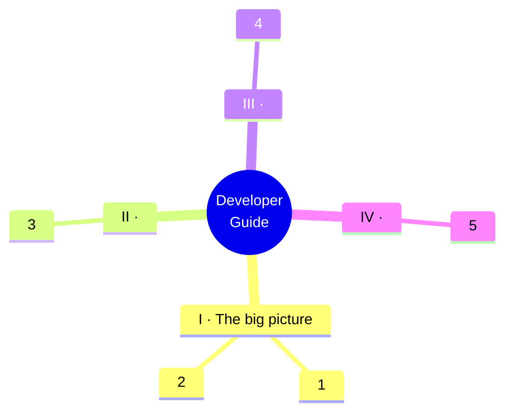

# <Title> — Developer Guide

**A guided tour of <the project>: what it does, how a <request/job/command> travels through it, and why every rule exists.**

> [!NOTE]
> **Who this guide is for**
>
> <The reader: who changes this code, consumes it or runs it.> You need <the prerequisites>; everything else is explained here.

<!-- stats -->
| <n> | <n> | <n> | <n> | <n> |
| --- | --- | --- | --- | --- |
| <label> | <label> | <label> | <label> | <label> |

## The guide at a glance

## Contents

### Part I · The big picture

| Chapter | What you will learn |
| --- | --- |
| [1 · <Chapter title>](01-<slug>.md) | <One line: what the reader will understand> |
| [2 · <Chapter title>](02-<slug>.md) | <One line> |

### Part II · <Part title>

| Chapter | What you will learn |
| --- | --- |
| [3 · <Chapter title>](03-<slug>.md) | <One line> |

## Reading paths

| If you want to… | Read |
| --- | --- |
| understand the project in twenty minutes | 1 → 2 → <n> |
| make your first change | 1 → <n> → <n> |

## How the pages are marked up

Every chapter opens with what it covers and ends with a few questions to check yourself. Five kinds of box stand out from the text:

> [!NOTE]
> Background worth knowing, but not a rule.

> [!TIP]
> A habit or shortcut that saves you a round trip.

> [!IMPORTANT]
> **Why?** The reason behind a decision.

> [!WARNING]
> A mistake people make often, or a sharp edge in the code.

> [!CAUTION]
> A hard rule. Something breaks in production if you ignore it.

## Where the rules really live

This guide explains; the code decides. When the two disagree, the files below win, and the guide needs fixing.

| Topic | Source of truth |
| --- | --- |
| <topic> | `<path>` |

*Written against <project> <version> on <as_of>.*

> **Printable editions.** The same guide as a designed book: [PDF](../<name>-developer-guide.pdf) for printing, [Word](../<name>-developer-guide.docx) for editing. Both are built from these pages; rebuild them when the pages change.
>
> 
